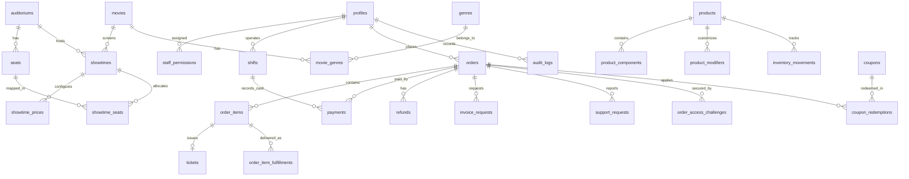

# CINEMAX — TÀI LIỆU THIẾT KẾ KIẾN TRÚC CSDL & MA TRẬN PHÂN QUYỀN CHUẨN HÓA (RE-DESIGN)
> **Phiên bản:** 3.0 Production-Ready (Mô hình 1 Cụm Rạp Tiêu Chuẩn - Single Theater MVP)  
> **Dự án:** Website Đặt Vé Xem Phim Trực Tuyến CINEMAX  
> **Nhóm thực hiện:** HK2T — FPT Polytechnic (Leader: Trương Công Tiến)  
> **Cập nhật ngày:** 13/10/2026  
> **Nguồn đối chiếu:** File Excel `HK2T_1-rap_database-redesign.xlsx`

---

## 1. TỔNG QUAN CHIẾN LƯỢC TÁI THIẾT KẾ (RE-DESIGN RATIONALE)

### 1.1. Chuyển dịch từ Đa Cụm Rạp sang 1 Rạp Tiêu Chuẩn (Single Theater)
- **Vấn đề cũ:** Schema 17 bảng trước đây chia cụm rạp (`cinemas`) và phòng chiếu (`rooms`), dẫn đến nghiệp vụ phân tán, xử lý giá vé và ca trực cồng kềnh, không tập trung giải quyết triệt để các bài toán vận hành cốt lõi tại quầy.
- **Giải pháp mới:** Tinh giản cấu trúc, loại bỏ bảng `cinemas`, đưa `auditoriums` làm thực thể phòng chiếu trực tiếp của rạp. Dồn toàn bộ sức mạnh hệ thống vào xử lý:
  1. **Chống đặt trùng ghế thời gian thực (Race Condition)** qua Nguồn sự thật duy nhất `showtime_seats`.
  2. **Quản lý ca trực tiền mặt (`shifts`)** gắn liền với quầy máy POS (`pos_terminal`).
  3. **Quản lý kho bắp nước (`inventory_movements`)** theo dõi biến động nguyên liệu và tùy chọn đổi vị/size (`product_modifiers`).
  4. **Cơ chế bảo mật Zero-Leakage OTP** cho khách vãng lai (`order_access_challenges`).

---

## 2. MA TRẬN PHÂN QUYỀN HỆ THỐNG (RBAC MATRIX CHI TIẾT)

Hệ thống phân chia 4 nhóm tác nhân với phân định ranh giới bảo mật nghiêm ngặt:
- **ADMIN:** Quản trị viên tối cao của rạp.
- **STAFF:** Nhân viên rạp, được cấp phát 1 hoặc nhiều nhiệm vụ: `POS`, `CHECKIN`, `CONCESSION`, `SUPERVISOR`.
- **USER:** Khách hàng thành viên có tài khoản xác thực, tích lũy điểm thưởng.
- **GUEST:** Khách vãng lai mua vé nhanh, tra cứu qua OTP/Challenge hash.

### Bảng Ma Trận Phân Quyền Theo Nghiệp Vụ

| Nhóm Nghiệp Vụ | Chức Năng Cụ Thể | GUEST | USER | STAFF: POS | STAFF: CHECKIN | STAFF: CONCESSION | STAFF: SUPERVISOR | ADMIN |
|---|---|:---:|:---:|:---:|:---:|:---:|:---:|:---:|
| **Khám phá** | Xem phim, trailer, lịch chiếu, giá vé | ✓ | ✓ | ✓ | ✓ | ✓ | ✓ | ✓ |
| **Đặt vé Online** | Giữ ghế 10p, chọn combo, thanh toán online | ✓ | ✓ | - | - | - | - | - |
| **Quầy Vé POS** | Bán vé tại quầy (tiền mặt / QR tĩnh) | ✗ | ✗ | ✓ | ✗ | ✗ | ✓ | ✓ |
| **Quầy Vé POS** | Bán vé trễ (<15 phút sau giờ chiếu) | ✗ | ✗ | ✓ | ✗ | ✗ | ✓ | ✓ |
| **Quầy Vé POS** | Mở ca / Đếm tiền chốt ca quầy | ✗ | ✗ | ✓ | ✗ | ✗ | ✓ | ✓ |
| **Soát Vé** | Quét QR vé vào cửa, đổi vé sang `USED` | ✗ | ✗ | ✗ | ✓ | ✗ | ✓ | ✓ |
| **Soát Vé** | Xác minh độ tuổi (`T13`/`T16`/`T18`), từ chối nếu sai | ✗ | ✗ | ✗ | ✓ | ✗ | ✓ | ✓ |
| **Bắp Nước** | Quét QR đơn trả bắp nước (`fulfillments`) | ✗ | ✗ | ✗ | ✗ | ✓ | ✓ | ✓ |
| **Bắp Nước** | Kiểm kê kho, nhập/xuất/hủy kho (`movements`) | ✗ | ✗ | ✗ | ✗ | ✓ | ✓ | ✓ |
| **Hậu Mãi** | Đổi vé / Đổi ghế trước giờ chiếu | ✗ | ✗ | ✓ | ✗ | ✗ | ✓ | ✓ |
| **Hậu Mãi** | Duyệt chốt ca & chênh lệch tiền két | ✗ | ✗ | ✗ | ✗ | ✗ | ✓ | ✓ |
| **Hậu Mãi** | Hủy suất chiếu sự cố kỹ thuật hàng loạt | ✗ | ✗ | ✗ | ✗ | ✗ | ✗ | ✓ |
| **Hậu Mãi** | Duyệt hoàn tiền (`refunds`) về tài khoản | ✗ | ✗ | ✗ | ✗ | ✗ | ✗ | ✓ |
| **Hóa Đơn** | Yêu cầu xuất hóa đơn VAT điện tử | ✓ | ✓ | ✓ | ✗ | ✗ | ✓ | ✓ |
| **Tra Cứu Vé** | Tra cứu vé cá nhân / Xác thực OTP Guest | ✓ (OTP) | ✓ (User ID) | ✓ | ✓ | ✓ | ✓ | ✓ |
| **Hội Viên** | Tích lũy điểm thưởng & Tiêu điểm | ✗ | ✓ | ✓ (POS nạp) | ✗ | ✗ | ✗ | ✓ |
| **Cấu Hình** | Lập lịch chiếu, chỉnh giá vé, tạo phim, sơ đồ ghế | ✗ | ✗ | ✗ | ✗ | ✗ | ✗ | ✓ |
| **Báo Cáo** | Xem doanh thu Box Office, F&B, Audit Logs | ✗ | ✗ | ✗ | ✗ | ✗ | ✗ | ✓ |

---

## 3. THIẾT KẾ CƠ SỞ DỮ LIỆU HOÀN CHỈNH (28 BẢNG DỮ LIỆU)

### 3.1. Sơ Đồ Quan Hệ Thực Thể (ERD Diagram)

---

### 3.2. Từ Điển Dữ Liệu Chi Tiết (Data Dictionary)

#### Nhóm 1: Tài Khoản, Phân Quyền & Cấu Hình Hệ Thống

1. **`profiles`** (Hồ sơ người dùng & Thành viên):
   - `id uuid PK`: Khóa chính liên kết 1-1 với `auth.users(id)` ON DELETE CASCADE.
   - `role user_role_t NOT NULL`: Enum (`admin`, `staff`, `user`).
   - `full_name text NOT NULL`: Họ và tên.
   - `phone varchar(20) UNIQUE`: Số điện thoại liên hệ.
   - `loyalty_points int DEFAULT 0 CHECK (loyalty_points >= 0)`: Điểm thưởng tích lũy hội viên.
   - `membership_tier varchar(20) DEFAULT 'MEMBER'`: Hạng hội viên (`MEMBER`, `VIP`, `VVIP`).
   - `status account_status_t DEFAULT 'active'`: Enum (`active`, `blocked`).
   - `created_at, updated_at timestamptz`.

2. **`staff_permissions`** (Nhiệm vụ chuyên biệt của nhân viên):
   - `id uuid PK`: Khóa chính.
   - `staff_id uuid FK profiles(id) ON DELETE CASCADE`.
   - `permission staff_perm_t NOT NULL`: Enum (`POS`, `CHECKIN`, `CONCESSION`, `SUPERVISOR`).
   - `active boolean DEFAULT true`.
   - `assigned_by uuid FK profiles(id)`.
   - `assigned_at timestamptz DEFAULT now()`.
   - *Ràng buộc:* `UNIQUE(staff_id, permission)`.

3. **`cinema_settings`** (Cấu hình vận hành rạp):
   - `setting_key varchar(50) PK`: Tên cấu hình (`cleaning_buffer_minutes`, `hold_duration_minutes`, `late_sales_minutes`, `loyalty_rate`, `cancel_deadline_minutes`, `hotline`, `address`).
   - `setting_value jsonb NOT NULL`: Giá trị JSON lưu trữ.
   - `updated_by uuid FK profiles(id)`, `updated_at timestamptz`.

4. **`content_items`** (Nội dung truyền thông & Khuyến mãi):
   - `id uuid PK`.
   - `type content_type_t NOT NULL`: Enum (`banner`, `post`, `promotion`).
   - `title text NOT NULL`, `body text`, `image_url text`, `link_url text`.
   - `published_at, expires_at timestamptz`.
   - `status content_status_t DEFAULT 'draft'` (`draft`, `published`, `archived`).

---

#### Nhóm 2: Phim, Thể Loại, Phòng Chiếu & Suất Chiếu

5. **`genres`** (Thể loại phim):
   - `id uuid PK`.
   - `name varchar(50) NOT NULL`.
   - `slug varchar(60) UNIQUE NOT NULL`.
   - `active boolean DEFAULT true`.

6. **`movies`** (Danh mục phim):
   - `id uuid PK`.
   - `title text NOT NULL`, `slug varchar(120) UNIQUE NOT NULL`.
   - `synopsis text`, `director varchar(100)`, `cast_list text`, `language varchar(50)`.
   - `duration_minutes smallint NOT NULL CHECK (duration_minutes > 0)`.
   - `age_rating age_rating_t NOT NULL`: Enum chuẩn điện ảnh (`P`, `K`, `T13`, `T16`, `T18`).
   - `poster_url text`, `banner_url text`, `trailer_url text`.
   - `release_date, end_date date`.
   - `status movie_status_t DEFAULT 'coming_soon'` (`draft`, `coming_soon`, `now_showing`, `ended`).

7. **`movie_genres`** (Bảng nối Phim - Thể loại):
   - `movie_id uuid FK movies(id) ON DELETE CASCADE`.
   - `genre_id uuid FK genres(id) ON DELETE CASCADE`.
   - *Ràng buộc:* `PK(movie_id, genre_id)`.

8. **`auditoriums`** (Phòng chiếu phim):
   - `id uuid PK`.
   - `name varchar(50) UNIQUE NOT NULL`: Tên phòng (Phòng 1, Phòng 2, IMAX Cinema).
   - `screen_type screen_type_t DEFAULT '2D'` (`2D`, `3D`, `IMAX`, `4DX`).
   - `sound_system varchar(50) DEFAULT 'Dolby 7.1'`: Công nghệ âm thanh.
   - `total_seats smallint NOT NULL CHECK (total_seats > 0)`.
   - `cleaning_buffer_minutes smallint DEFAULT 15`: Thời gian dọn dẹp phòng tối thiểu giữa 2 suất chiếu.
   - `status room_status_t DEFAULT 'active'` (`active`, `maintenance`).
   - `seat_map_version int DEFAULT 1`.

9. **`seats`** (Sơ đồ vị trí ghế mẫu):
   - `id uuid PK`.
   - `auditorium_id uuid FK auditoriums(id) ON DELETE CASCADE`.
   - `row_label varchar(3) NOT NULL`: Hàng ghế (A, B, C, D...).
   - `seat_number smallint NOT NULL`: Số thứ tự ghế (1, 2, 3...).
   - `grid_row smallint NOT NULL, grid_col smallint NOT NULL`: Tọa độ ma trận trên giao diện chọn ghế (dùng vẽ sơ đồ trực quan và tính toán quy tắc chống bỏ trống 1 ghế đơn lẻ).
   - `seat_type seat_type_t DEFAULT 'STANDARD'` (`STANDARD`, `VIP`, `COUPLE`, `WHEELCHAIR`).
   - `seat_group varchar(20) NULL`: Định danh nhóm ghế đôi (bắt buộc chọn cùng lúc cả cặp).
   - `status seat_status_t DEFAULT 'ACTIVE'` (`ACTIVE`, `BLOCKED`).
   - `block_reason varchar(100) NULL`: Lý do khóa ghế (Hỏng hóc, bảo trì, ghế kỹ thuật).
   - *Ràng buộc:* `UNIQUE(auditorium_id, row_label, seat_number)`.

10. **`showtimes`** (Lịch suất chiếu):
    - `id uuid PK`.
    - `movie_id uuid FK movies(id)`.
    - `auditorium_id uuid FK auditoriums(id)`.
    - `format varchar(20) DEFAULT '2D'`, `language_version varchar(50) DEFAULT 'Phụ đề Tiếng Việt'`.
    - `starts_at timestamptz NOT NULL`.
    - `ends_at timestamptz NOT NULL`: Tự động tính = `starts_at + movie.duration + auditorium.cleaning_buffer`.
    - `booking_opens_at, booking_closes_at timestamptz`.
    - `status showtime_status_t DEFAULT 'scheduled'` (`scheduled`, `open`, `closed`, `cancelled`, `finished`).
    - *Ràng buộc:* `EXCLUDE USING gist (auditorium_id WITH =, tstzrange(starts_at, ends_at) WITH &&) WHERE (status != 'cancelled')` — Chống trùng phòng chiếu tuyệt đối.

11. **`showtime_prices`** (Bảng giá vé phân tầng đa chiều):
    - `id uuid PK`.
    - `showtime_id uuid FK showtimes(id) ON DELETE CASCADE`.
    - `seat_type seat_type_t NOT NULL` (`STANDARD`, `VIP`, `COUPLE`, `WHEELCHAIR`).
    - `audience_type audience_type_t NOT NULL` (`ADULT`, `STUDENT_U22`, `CHILD`, `SENIOR`).
    - `price numeric(12,0) NOT NULL CHECK (price >= 0)`.
    - `currency char(3) DEFAULT 'VND'`.
    - *Ràng buộc:* `UNIQUE(showtime_id, seat_type, audience_type)`.

12. **`showtime_seats`** (Nguồn sự thật trạng thái ghế theo từng suất):
    - `showtime_id uuid FK showtimes(id) ON DELETE CASCADE`.
    - `seat_id uuid FK seats(id) ON DELETE CASCADE`.
    - `status showtime_seat_status_t DEFAULT 'available'` (`available`, `held`, `sold`, `blocked`).
    - `held_until timestamptz NULL`: Hạn giữ ghế tạm thời (10 phút).
    - `order_id uuid FK orders(id) NULL`: Đơn hàng đang giữ/đã mua ghế này.
    - *Ràng buộc:* `PK(showtime_id, seat_id)`.

---

#### Nhóm 3: Bắp Nước, Combo, Tùy Chọn & Quản Lý Kho F&B

13. **`products`** (Sản phẩm Bắp Nước & Combo):
    - `id uuid PK`.
    - `name varchar(100) NOT NULL`.
    - `product_type product_type_t NOT NULL` (`FOOD`, `BEVERAGE`, `COMBO`).
    - `base_price numeric(12,0) NOT NULL CHECK (base_price >= 0)`.
    - `inventory_tracking boolean DEFAULT true`.
    - `available_stock int DEFAULT 0 CHECK (available_stock >= 0)`: Số dư khả dụng tự động cập nhật bởi Trigger.
    - `active boolean DEFAULT true`, `image_url text`.

14. **`product_components`** (Định lượng thành phần Combo):
    - `combo_id uuid FK products(id) ON DELETE CASCADE`.
    - `component_id uuid FK products(id)`.
    - `quantity smallint NOT NULL CHECK (quantity > 0)`.
    - *Ràng buộc:* `PK(combo_id, component_id)`, `CHECK (combo_id != component_id)`.

15. **`product_modifiers`** (Tùy chọn đổi vị / đổi size / phụ thu F&B):
    - `id uuid PK`.
    - `product_id uuid FK products(id) ON DELETE CASCADE`.
    - `modifier_group varchar(50) NOT NULL`: Nhóm tùy chọn (`Vị bắp`, `Đổi loại nước`, `Kích cỡ`).
    - `option_name varchar(50) NOT NULL`: Tên tùy chọn (`Phô mai`, `Caramel`, `Trà đào`, `Size L`).
    - `extra_price numeric(12,0) DEFAULT 0 CHECK (extra_price >= 0)`: Phụ thu thêm.
    - `is_default boolean DEFAULT false`, `active boolean DEFAULT true`.

16. **`inventory_movements`** (Sổ biến động kho bắp nước - Append-Only):
    - `id uuid PK`.
    - `product_id uuid FK products(id)`.
    - `movement_type movement_type_t NOT NULL` (`IMPORT`, `SALE`, `LOSS`, `ADJUSTMENT`).
    - `quantity int NOT NULL`: Số lượng (Dương = Nhập kho/Điều chỉnh tăng; Âm = Bán ra/Hủy hỏng).
    - `reason text NOT NULL`: Lý do biến động.
    - `reference_order_item_id uuid FK order_items(id) NULL`.
    - `created_by uuid FK profiles(id)`, `created_at timestamptz DEFAULT now()`.

---

#### Nhóm 4: Khuyến Mãi, Đơn Hàng, Chi Tiết Dòng Hàng & Vé Điện Tử

17. **`coupons`** (Chính sách mã giảm giá):
    - `id uuid PK`.
    - `code varchar(30) UNIQUE NOT NULL`.
    - `discount_type discount_type_t NOT NULL` (`PERCENT`, `FIXED`).
    - `discount_value numeric(12,0) NOT NULL CHECK (discount_value > 0)`.
    - `max_discount numeric(12,0) NULL`: Trần giảm giá tối đa khi dùng `PERCENT`.
    - `min_order_amount numeric(12,0) DEFAULT 0`.
    - `apply_scope coupon_scope_t DEFAULT 'ALL'` (`ALL`, `TICKET_ONLY`, `COMBO_ONLY`): Phạm vi áp dụng mã.
    - `starts_at, ends_at timestamptz NOT NULL`.
    - `usage_limit int NULL`, `per_user_limit int DEFAULT 1`.
    - `active boolean DEFAULT true`.

18. **`coupon_redemptions`** (Lịch sử sử dụng mã giảm giá):
    - `id uuid PK`.
    - `coupon_id uuid FK coupons(id)`.
    - `order_id uuid FK orders(id)`.
    - `user_id uuid FK profiles(id) NULL`.
    - `redeemed_at timestamptz DEFAULT now()`.
    - *Ràng buộc:* `UNIQUE(coupon_id, order_id)`.

19. **`orders`** (Đơn hàng tổng thể vé & bắp nước):
    - `id uuid PK`.
    - `order_code varchar(20) UNIQUE NOT NULL`: Mã đơn hiển thị (VD: `CNM261013-8899`).
    - `user_id uuid FK profiles(id) NULL`: NULL nếu là Khách vãng lai (`GUEST`).
    - `guest_access_hash text NULL`: Mã băm bí mật cấp riêng cho phiên khách vãng lai.
    - `channel order_channel_t NOT NULL` (`online`, `pos`).
    - `created_by uuid FK profiles(id) NULL`: Nhân viên quầy tạo đơn (nếu tại quầy POS).
    - `status order_status_t DEFAULT 'pending'` (`pending`, `paid`, `cancelled`, `expired`, `refunded`).
    - `contact_name varchar(100) NOT NULL`.
    - `contact_email varchar(100) NOT NULL`.
    - `contact_phone varchar(20) NOT NULL`.
    - `subtotal numeric(12,0) NOT NULL`: Tổng tiền gốc.
    - `discount_amount numeric(12,0) DEFAULT 0`: Số tiền giảm giá từ coupon.
    - `loyalty_points_used int DEFAULT 0`: Số điểm thưởng hội viên đã dùng.
    - `loyalty_discount_amount numeric(12,0) DEFAULT 0`: Số tiền giảm trừ từ điểm hội viên.
    - `total_amount numeric(12,0) NOT NULL`: Số tiền thực thanh toán cuối cùng.
    - `coupon_id uuid FK coupons(id) NULL`.
    - `expires_at timestamptz NULL`: Hạn thanh toán giữ đơn (10 phút).
    - `created_at timestamptz DEFAULT now()`.

20. **`order_items`** (Dòng chi tiết vé và hàng hóa):
    - `id uuid PK`.
    - `order_id uuid FK orders(id) ON DELETE CASCADE`.
    - `item_type order_item_type_t NOT NULL` (`ticket`, `product`).
    - `showtime_seat_id FK showtime_seats NULL`: Khóa ngoại trỏ đến cặp `(showtime_id, seat_id)`.
    - `product_id uuid FK products(id) NULL`.
    - `audience_type audience_type_t NULL`: Loại đối tượng khán giả (`ADULT`, `STUDENT_U22`, `CHILD`, `SENIOR`).
    - `selected_modifiers jsonb NULL`: Mảng JSON lưu tùy chọn đổi vị/size bắp nước khách đã chọn.
    - `quantity smallint NOT NULL CHECK (quantity > 0)`.
    - `unit_price numeric(12,0) NOT NULL`: Đơn giá chốt tại thời điểm mua.
    - `line_total numeric(12,0) NOT NULL`: Thành tiền dòng = `quantity * unit_price`.
    - `item_snapshot jsonb NOT NULL`: Ảnh chụp dữ liệu bất biến (Tên phim, suất chiếu, số ghế, tên món).

21. **`order_item_fulfillments`** (Xác nhận trả hàng Bắp Nước tại quầy):
    - `id uuid PK`.
    - `order_item_id uuid FK order_items(id)`.
    - `quantity smallint NOT NULL CHECK (quantity > 0)`.
    - `delivered_at timestamptz DEFAULT now()`.
    - `delivered_by uuid FK profiles(id)`: Nhân viên quầy bắp nước thực hiện trả món.

22. **`tickets`** (Vé xem phim điện tử mã QR):
    - `id uuid PK`.
    - `order_item_id uuid FK order_items(id) UNIQUE`: Mỗi dòng vé trong đơn ứng với 1 vé QR độc nhất.
    - `qr_token_hash text UNIQUE NOT NULL`: Mã băm bảo mật tạo mã QR soát vé.
    - `status ticket_status_t DEFAULT 'issued'` (`issued`, `used`, `cancelled`, `refunded`).
    - `age_check_passed boolean DEFAULT true`: Đánh dấu nhân viên soát vé đã đối chiếu CCCD/độ tuổi xem phim.
    - `checked_in_at timestamptz NULL`: Thời điểm khách vào phòng chiếu.
    - `checked_in_by uuid FK profiles(id) NULL`: Nhân viên soát vé thực hiện.

---

#### Nhóm 5: Thanh Toán, Ca Trực Tiền Mặt & Hậu Mãi

23. **`payments`** (Giao dịch thanh toán):
    - `id uuid PK`.
    - `order_id uuid FK orders(id)`.
    - `shift_id uuid FK shifts(id) NULL`: Gắn liền với ca trực quầy nếu thanh toán tiền mặt.
    - `received_by uuid FK profiles(id) NULL`: Thu ngân nhận tiền.
    - `provider payment_provider_t NOT NULL` (`CASH`, `MOMO`, `VNPAY`, `ZALOPAY`, `CARD`).
    - `provider_txn_id text UNIQUE NULL`: Mã giao dịch từ cổng hoặc số biên lai.
    - `amount numeric(12,0) NOT NULL`.
    - `status payment_status_t DEFAULT 'PENDING'` (`PENDING`, `SUCCESS`, `FAILED`, `REFUNDED`).
    - `payload jsonb NULL`: Dữ liệu phản hồi nguyên bản từ cổng thanh toán.
    - `paid_at timestamptz NULL`, `created_at timestamptz DEFAULT now()`.

24. **`shifts`** (Quản lý ca trực tiền mặt quầy vé & F&B):
    - `id uuid PK`.
    - `staff_id uuid FK profiles(id)`.
    - `pos_terminal varchar(30) NOT NULL`: Định danh máy/két tiền quầy (`POS-01`, `POS-02`, `CONCESSION-01`).
    - `shift_type varchar(20) DEFAULT 'MORNING'` (`MORNING`, `EVENING`, `FULLDAY`).
    - `opened_at timestamptz DEFAULT now()`.
    - `closed_at timestamptz NULL`.
    - `opening_cash numeric(12,0) NOT NULL DEFAULT 0`: Tiền lẻ tồn két đầu ca.
    - `expected_cash numeric(12,0) NOT NULL DEFAULT 0`: Tiền lý thuyết hệ thống tính = `opening_cash + SUM(CASH payments)`.
    - `counted_cash numeric(12,0) NULL`: Tiền mặt thực tế nhân viên đếm khi kết ca.
    - `variance_reason text NULL`: Giải trình nếu có chênh lệch thừa/thiếu tiền két.
    - `supervisor_id uuid FK profiles(id) NULL`: Trưởng ca kiểm tra và phê duyệt.
    - `approved_at timestamptz NULL`.
    - `status shift_status_t DEFAULT 'open'` (`open`, `submitted`, `closed`).
    - *Quy tắc:* Mỗi nhân viên chỉ có tối đa 1 ca mở (`status = 'open'`) tại một thời điểm.

25. **`refunds`** (Hồ sơ yêu cầu hoàn tiền & Đổi vé):
    - `id uuid PK`.
    - `order_id uuid FK orders(id)`.
    - `payment_id uuid FK payments(id) NULL`.
    - `refund_type refund_type_t NOT NULL` (`CUSTOMER_REQUEST`, `SYSTEM_SHOWTIME_CANCEL`, `EXCHANGE`).
    - `requested_by uuid FK profiles(id) NULL`: Người yêu cầu (NULL nếu hệ thống tự động hoàn do hủy suất).
    - `reason text NOT NULL`: Lý do hoàn tiền (Khách hủy trước 60p, rạp hỏng máy chiếu, đổi suất).
    - `amount numeric(12,0) NOT NULL CHECK (amount > 0)`.
    - `status refund_status_t DEFAULT 'pending'` (`pending`, `approved`, `rejected`, `completed`).
    - `approved_by uuid FK profiles(id) NULL`: Quản lý duyệt hoàn tiền.
    - `provider_ref text NULL`: Mã giao dịch hoàn tiền từ cổng thanh toán.
    - `created_at timestamptz DEFAULT now()`, `resolved_at timestamptz NULL`.

26. **`invoice_requests`** (Yêu cầu hóa đơn VAT điện tử):
    - `id uuid PK`.
    - `order_id uuid FK orders(id) UNIQUE`: Mỗi đơn hàng chỉ tạo tối đa 1 yêu cầu VAT.
    - `tax_code varchar(30) NOT NULL`: Mã số thuế doanh nghiệp.
    - `company_name text NOT NULL`: Tên công ty/tổ chức.
    - `address text NOT NULL`: Địa chỉ trụ sở.
    - `email varchar(100) NOT NULL`: Email nhận hóa đơn điện tử.
    - `status invoice_status_t DEFAULT 'pending'` (`pending`, `issued`, `rejected`).
    - `invoice_ref text NULL`: Số hóa đơn điện tử đã phát hành.
    - `requested_at timestamptz DEFAULT now()`, `resolved_at timestamptz NULL`.

27. **`support_requests`** (Yêu cầu hỗ trợ & Khiếu nại khách hàng):
    - `id uuid PK`.
    - `order_id uuid FK orders(id)`.
    - `type support_type_t NOT NULL` (`lost_ticket`, `contact_change`, `payment_pending`, `cancellation`, `seat_exchange`).
    - `description text NOT NULL`.
    - `status support_status_t DEFAULT 'pending'` (`pending`, `in_progress`, `resolved`, `closed`).
    - `created_by uuid FK profiles(id) NULL`.
    - `guest_access_hash text NULL`.
    - `assigned_to uuid FK profiles(id) NULL`: Nhân viên chịu trách nhiệm xử lý.
    - `created_at timestamptz DEFAULT now()`, `resolved_at timestamptz NULL`.

28. **`order_access_challenges`** (Cơ chế OTP tra cứu an toàn Zero-Leakage cho Khách vãng lai):
    - `id uuid PK`.
    - `order_id uuid FK orders(id)`.
    - `channel challenge_channel_t NOT NULL` (`email`, `sms`).
    - `destination_hash text NOT NULL`: Mã băm SHA-256 của Email hoặc Số điện thoại.
    - `otp_hash text NOT NULL`: Mã băm SHA-256 của mã OTP 6 chữ số (hết hạn sau 5 phút).
    - `token_hash text NOT NULL`: Mã băm token truy cập cấp cho phiên người dùng sau khi xác thực OTP thành công.
    - `expires_at timestamptz NOT NULL`.
    - `attempts smallint DEFAULT 0 CHECK (attempts <= 5)`: Tối đa 5 lần thử chống Brute-force.
    - `verified_at timestamptz NULL`.

29. **`audit_logs`** (Nhật ký kiểm toán an toàn hệ thống - Append-Only):
    - `id uuid PK`.
    - `actor_id uuid FK profiles(id) NULL`: Người thực hiện (hoặc NULL nếu là trigger hệ thống/khách vãng lai).
    - `action varchar(100) NOT NULL`: Tên hành động (`HOLD_SEATS`, `CANCEL_ORDER`, `CHECKIN_TICKET`, `CLOSE_SHIFT`, `REFUND_APPROVED`).
    - `entity_type varchar(50) NOT NULL`: Tên bảng bị tác động (`orders`, `tickets`, `shifts`...).
    - `entity_id text NOT NULL`: ID bản ghi.
    - `before_data jsonb NULL`: Dữ liệu trước khi sửa.
    - `after_data jsonb NULL`: Dữ liệu sau khi sửa.
    - `created_at timestamptz DEFAULT now()`.
    - *Bảo mật:* Tuyệt đối cấm ghi mật khẩu, token QR gốc, secret key hoặc mã CVV/OTP vào audit_logs.

---

## 4. CÁC STORED PROCEDURES / RPC ATOMIC SỐNG CÒN

Toàn bộ các logic nghiệp vụ quan trọng đều được đóng gói thành các hàm Stored Procedure chạy nguyên tử (ACID Transaction) trong PostgreSQL để đảm bảo không bị Race Condition:

### 4.1. Hàm `hold_seats(p_showtime_id, p_seat_ids, p_user_id, p_channel, p_contact_info)`
1. Khóa các hàng trong `showtime_seats` bằng `FOR UPDATE`.
2. Kiểm tra nếu có bất kỳ ghế nào đã bị `held` (chưa hết hạn) hoặc `sold` hoặc `blocked` $\rightarrow$ Rollback và ném lỗi `"Ghế vừa có người khác chọn"`.
3. **Kiểm tra ràng buộc Ghế Đôi (`Couple`):** Nếu một ghế thuộc nhóm `seat_group`, bắt buộc mảng `p_seat_ids` phải chứa toàn bộ các ghế thuộc nhóm đó $\rightarrow$ Chặn chọn lẻ 1 ghế của cặp đôi.
4. **Kiểm tra quy tắc Orphan Seat:** Kiểm tra các ghế trống xung quanh trong cùng hàng xem có bị chừa lại đúng 1 ghế lẻ cô lập hay không.
5. Cập nhật `status = 'held'`, `held_until = now() + interval '10 minutes'`.
6. Tạo bản ghi `orders` tạm thời (`status = 'pending'`).

### 4.2. Hàm `check_in_ticket(p_ticket_id, p_staff_id, p_age_check_passed)`
1. Khóa vé bằng `FOR UPDATE`.
2. Kiểm tra trạng thái: Nếu `status = 'used'` $\rightarrow$ Báo lỗi `"Vé đã được soát vào lúc ... bởi nhân viên ..."`.
3. Nếu `status != 'issued'` $\rightarrow$ Báo lỗi `"Vé không hợp lệ hoặc đã bị hủy/hoàn"`.
4. Nếu `p_age_check_passed = false` $\rightarrow$ Từ chối soát vé, ghi nhận vi phạm độ tuổi và chuyển hướng khách sang quầy POS hỗ trợ.
5. Cập nhật `status = 'used'`, `checked_in_at = now()`, `checked_in_by = p_staff_id`, `age_check_passed = true`.

### 4.3. Hàm `cancel_showtime_bulk(p_showtime_id, p_admin_id, p_reason)`
1. Cập nhật `showtimes.status = 'cancelled'`.
2. Lấy tất cả các ghế `showtime_seats` đang `sold` hoặc `held` $\rightarrow$ Chuyển về `available`.
3. Tìm tất cả `orders` trạng thái `paid` thuộc suất chiếu đó $\rightarrow$ Đổi sang `refunded`.
4. Tự động tạo các bản ghi `refunds` (`refund_type = 'SYSTEM_SHOWTIME_CANCEL'`, `status = 'approved'`, `requested_by = NULL`).
5. Kích hoạt Webhook hoàn tiền tự động qua cổng thanh toán và gửi Email/SMS thông báo xin lỗi kèm mã Voucher bồi thường đến tất cả khách hàng.

---

## 5. ĐÁNH GIÁ CHUẨN ĐỒ ÁN TỐT NGHIỆP FPT POLYTECHNIC

| Tiêu Chí Đánh Giá Của Giảng Viên | Bản Cũ (17 Bảng) | Bản Re-Design Chuẩn Hóa (28 Bảng) |
|---|---|---|
| **Mô hình kinh doanh** | Lan man giữa rạp đơn và chuỗi rạp | Chuẩn mô hình 1 rạp tiêu chuẩn (Single Theater), nghiệp vụ sâu và sát thực tế |
| **Phân quyền người dùng** | Gộp chung Staff không rõ nhiệm vụ | Chia rõ 4 vai trò: `Admin`, `POS`, `CHECKIN`, `CONCESSION`, `SUPERVISOR`, `User`, `Guest` |
| **Chống Race Condition** | Khóa ghế lỏng lẻo ở bảng vé | `showtime_seats` làm Single Source of Truth + Postgres atomic lock |
| **Nghiệp vụ Ghế Đôi & Ghế Đơn Lẻ** | Không có | Có `seat_group` và quy tắc thuật toán chống để trống 1 ghế lẻ |
| **Chính sách Giá Vé** | Chỉ chia theo loại ghế | Phân tầng đa chiều: Loại ghế $\times$ Đối tượng (Người lớn, HSSV, Trẻ em, Người già) |
| **Nghiệp vụ Bắp Nước F&B** | Sản phẩm phẳng | Có định lượng Combo, Sổ kho biến động và tùy chọn đổi vị/size |
| **Vận hành Quầy Bán Vé** | Không có ca trực | Có quản lý ca trực tiền mặt (`shifts`), két tiền quầy POS, kiểm đếm chênh lệch cuối ngày |
| **Bảo mật Khách vãng lai** | Nhập SĐT là xem được vé người khác | Cơ chế Zero-Leakage OTP/Challenge hash bảo vệ quyền riêng tư 100% |

Bản thiết kế này đáp ứng trọn vẹn tiêu chuẩn của một hệ thống bán vé rạp chiếu phim thương mại thực thụ và hoàn toàn đủ điều kiện bảo vệ đạt điểm xuất sắc trước hội đồng tốt nghiệp.
